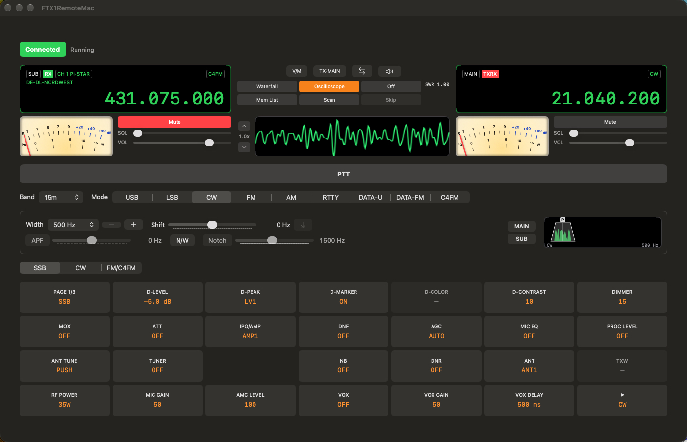

# FTX1Remote



Native apps to remotely control and monitor a Yaesu FTX-1 amateur radio
transceiver — Mac, iPad, iPhone and Windows — built because the radio lives
at home on USB and this makes it usable from the desk or from anywhere over
Tailscale, without needing hamlib's `rigctld_control.py` or a physical
presence next to the rig.

Single-user tool: no multi-user auth/permissions model.

`Package.swift` builds the shared Swift packages consumed by the Mac, iPad
and iPhone targets: `FTX1Core` (state, wire protocol, rigctld client,
audio, APRS, shared SwiftUI views), `FTX1CW` (CW receive/send on CWKit, Mac
and iPad only) and `FT8Kit` (FT8 decoding, Mac only). The Windows app shares
no code with them (Swift/SwiftUI isn't viable there) but mirrors their shape
in C#.

## Architecture

- **rigctld (hamlib) is the single source of truth for the hardware.** No
  app speaks CAT over the serial port itself; everything goes through a
  rigctld on TCP port 4532, including the FTX-1 menu settings hamlib has no
  verb for (raw CAT passthrough, see below).
- **rigctld runs on the machine the radio's USB is plugged into** — the Mac,
  a Raspberry Pi 2B on the tailnet, or the Windows PC. The USB cable moves,
  so every mode stays supported side by side.
- **Who talks to rigctld:**
  - **Mac app**, in Local mode (`RigctldSettings.connectionMode = .local`)
    against a rigctld it spawns or adopts on `localhost:4532`, or in Remote
    mode (`.remote`) against the Pi's (`<remoteHost>:4532`, a Tailscale
    MagicDNS name; no process management at all). Switching modes needs an
    app relaunch (Settings offers "Restart Now").
  - **Windows app**, in Remote mode straight to the Pi (the Mac needn't be
    running), or in Local mode against a `rigctld.exe` it spawns or adopts.
  - **iPad and iPhone, "Pi direct" route**: straight to the Pi's rigctld
    and audio streams, no desktop app in between (`PiDirectViewModel`).
- **Spawning and adopting rigctld (Mac Local, Windows Local).** On launch
  the app probes the port and adopts an already-running, responsive rigctld
  rather than killing it (another client, e.g. WSJT-X, may be mid-session
  with it). The model is checked first (`\dump_caps`): a rigctld for another
  rig is refused, never killed. Only an unresponsive/stale one gets
  replaced. Which binary it launches is "Automatic" by default: an installed
  Hamlib ≥ 4.7 that knows the FTX-1 (model 1051 first appears in 4.7), else
  the copy of Hamlib 4.7.2 the app ships.
- **Desktop hub for the iPad/iPhone.** The Mac app runs a WebSocket server
  (`RigWebSocketServer`, `NWListener` + `NWProtocolWebSocket`) that
  broadcasts state and accepts commands; the Windows app serves the same
  protocol (Settings → Hub, off by default, port 8765). The mobile apps'
  "Desktop hub" route (`RigClientViewModel` over `RigWebSocketClient`)
  connects to either over Tailscale.
- **The Mac's own UI calls `HubService` directly**, not through a WebSocket
  round trip to itself; `HubService` still broadcasts every applied command
  to remote clients however it was triggered.
- **Wire protocol is JSON.** Fire-and-forget `RigCommand`s from the client,
  push-based `RigStatePush` state from the hub (VFOs, mode, meters, PTT,
  MENU grid and filter fields — clients don't poll), plus a few lists
  pushed on change (memory channels, APRS history) and request/reply pairs
  kept beside `RigCommand` for things that need an answer (Deep Settings
  item reads, CW keyer memory writes). Binary frames carry audio: Main and
  Sub receive audio to the client, transmit audio from it (8 kHz mono,
  tag-byte framed, `AudioStreamFormat`).
- **Views shared across targets are generic over `RigController`**
  (`Sources/FTX1Core/UI/RigController.swift`): `HubService` (Mac),
  `RigClientViewModel` (hub route) and `PiDirectViewModel` (Pi direct) all
  conform, so `MenuPageView`, `DeepSettingsView`, the filter controls and
  `VFODisplayBox` are one file each, not one per target.
- **Commands are serialized** through `CommandQueue`, since rigctld handles
  one request/response cycle at a time.
- **A transmit-safety interlock gates everything that can key the radio**
  (PTT, MOX, ANT TUNE, CW keyer plays, CW key/paddle keying): an **Enable
  Transmit** lock plus an amateur-band check on the transmitting side
  (`TransmitGate`). On the Mac it sits in `HubService.send(...)` and covers
  hub clients too (the iPad's hub screen can toggle it); Pi direct has its
  own lock on the iPad, off by default; Windows has its own port of it.
- **Two menu systems, both driven by raw CAT passthrough** — most FTX-1
  menu items have no hamlib func/level equivalent, per the CAT Operation
  Reference Manual:
  - The numbered **MENU grid** (`MenuPageView`) — one `RigCommand` case,
    `RigState` field and hand-written button per item. On the Mac, the iPad
    (both routes) and Windows. The FM/C4FM page is fully wired; the rest
    grows item by item — see `MenuPageView.swift` for coverage.
  - The page-3 **Deep Settings** screens (`DeepSettingsView`, a sheet from
    the FM page) — Radio/CW/Operation/Display/Extension/APRS Setting,
    addressed via "EX" P1/P2/P3. Driven by the table-driven
    `DeepSettingsCatalog` (~250+ items): adding an item is a catalog entry,
    not new code. On the Mac, the iPad (both routes) and Windows.
  - The manual has been wrong often enough (labels, digit widths, at least
    one value mapping) that new entries in either system are read from the
    manual directly and hardware-tested, never assumed from another Yaesu
    rig's conventions.
- **Audio is a separate path from rig control.** Local mode taps a sound
  card input (the rig's USB audio); Remote mode streams 44.1 kHz stereo from
  the Pi (`Pi/ftx1-audiostream.py`, raw TCP port 8532,
  `RemoteAudioStreamClient`). The FTX-1's USB audio is stereo in dual-VFO
  display (Main left, Sub right), and the app keeps the two as parallel mono
  pipelines: independent playback, mute/volume/squelch and APRS decode for
  each, and swap tracking (`audioChannelsSwapped`) so audio follows a
  Main/Sub swap made in the app or on the front panel (front-panel swaps are
  detected heuristically, with a manual override button). Squelch is
  quieting-based (`SquelchGate`), since the rig's USB audio is unsquelched.
  The Pi serves one receive audio client at a time.
- **Transmit audio.** The iPad's hold-to-talk PTT sends its microphone to the
  rig's USB audio input: over the hub WebSocket (the hub plays it into a
  chosen output device in Local mode, or forwards it to the Pi), or on Pi
  direct straight to `Pi/ftx1-txaudio.py` (port 8533), which also unkeys as
  a watchdog. Set the rig's per-mode MOD SOURCE to USB.
- **Waterfall/oscilloscope (Mac and Windows) is audio-derived, not
  CAT-derived**: an FFT over the Main audio with peak-hold-and-decay
  auto-gain, also feeding the Filter Function Display's spectrum. The
  display isn't sent to mobile; the iPad computes its own filter spectrum
  from the audio it receives.
- **High-rate state stays off `HubService`'s `@Published` surface.** Nearly
  every Mac view observes `HubService`, so anything published there
  re-renders the whole window; scope frames live in a small
  `ScopeFrameStore` observed only by the view that draws them. Follow the
  same pattern for any future high-rate state.
- **Filter controls and display.** WIDTH, IF SHIFT, notch, CONTOUR/APF and
  N/W plus a Filter Function Display (passband over a live spectrum),
  addressing MAIN or SUB via a side selector. Mac, iPad (both routes) and
  Windows.
- **APRS decoding runs in-app**, since CAT exposes no received
  station/message data: `AFSKDemodulator`/`AX25Frame`/`APRSDecoder`
  (`Sources/FTX1Core/APRS/`) on the 44.1 kHz audio, one decoder per
  receiver, gated to when APRS is on and that VFO is on the configured
  frequency. History is kept in `APRSStore` (`aprs-history.json`). Mac:
  S.LIST/M.LIST windows and a map; iPad: the same lists in a pane (Pi direct
  decodes on the iPad itself, the hub route shows the Mac's); Windows: lists,
  no map.
- **Memory channels.** A memory list (read channel by channel over CAT,
  cached in `memory-channels.json`) with MAIN/SUB recall, and the rig's own
  memory scan on MAIN or SUB (one side at a time) — Mac, iPad and Windows.
- **Optional WPSD hotspot integration** (`WPSDCallsignMonitor`): polls a
  Pi-Star-family hotspot dashboard (no API exists) for the callsign
  transmitting and the linked YSF reflector during C4FM, since no CAT
  command exposes either. Mac, iPad and Windows.
- **Digital modes and tools (Mac Tools menu):**
  - **FT8** decoding via vendored `ft8_lib` (`FT8Kit`), with optional
    upload of decodes to PSK Reporter.
  - **CW** decode (CWKit from the author's `cwdecode` repo; MAIN, SUB,
    WebSDR or an audio file) and send through the rig's keyer memories,
    with macros, a Log QSO pane (to MacLoggerDX over WSJT-X's UDP protocol)
    and worked-before colors from its log. The iPad has the same decoder
    and sender in a pane (no logging); Windows has its own port, logging to
    HRD Logbook.
  - **CW Key** (straight key or iambic paddle) — see below.
  - **WebSDR**: embeds a KiwiSDR, classic WebSDR or OpenWebRX receiver,
    follows the rig's frequency, can tune the rig from the page, and
    records audio.
  - **APRS** list, messages and map.
- **Demo Mode (iPad).** The Pi direct tab can run against an in-process
  simulated Pi (`Sources/FTX1Core/Simulator/`: a simulated rigctld, audio
  stream and TX sink on loopback), with its own isolated settings — for App
  Review and anyone without the hardware.
- **Updates.** The Mac app updates itself with Sparkle: Developer ID–signed,
  notarized releases on GitHub Releases, with `appcast.xml` at the repo
  root (`Scripts/release-mac.sh` builds, notarizes and generates it). The
  iPad app ships through TestFlight/the App Store.

## Module layout

```
Sources/FTX1Core/
├── RigState/      RigState, RigMode, BandPlan, HomeFrequency, the filter
│                  value spaces (FilterWidthTable, IFShift, IFNotch,
│                  IFContour, FilterPassbandModel, FilterSide,
│                  FilterStateReads), memory channels (MemoryChannelEntry,
│                  MemoryListStore, MemoryScan)
├── Networking/    WireMessage (the JSON protocol), RigctldClient (TCP to
│                  rigctld, incl. raw CAT passthrough), RigWebSocketClient +
│                  RigClientViewModel (hub route), PiDirectViewModel (Pi
│                  direct route)
├── Commands/      CommandQueue (serializes RigCommands into rigctld calls),
│                  TransmitGate
├── MenuSettings/  DeepSettingsCatalog, NarrowWidthPreset
├── Audio/         AudioStreamFormat, AudioPlaybackEngine, SquelchGate,
│                  RemoteAudioStreamClient / RemoteTXAudioClient (the Pi's
│                  audio ports), PiAudioDownsampler, TXAudioCapture,
│                  MicrophoneTransmitter, SharedAudioSession, FilterSpectrum
├── APRS/          AFSKDemodulator, AX25Frame, APRSPacket, APRSDecoder,
│                  APRSStore, APRSPersistence, APRSSettings
├── CWKey/         CW key/paddle keying: line parser, clock sync, jitter
│                  buffer, safety, feedback detector, engine; serial source,
│                  RTS/DTR keyer and drivers (macOS), CWRemoteKeyingDriver
├── Logbook/       LoggedQSO, ADIFRecord, ADIFMode, WSJTXMessage,
│                  WorkedStations
├── PSKReporter/   PSKReporterPacket (IPFIX encoder)
├── WPSD/          WPSDCallsignMonitor, WPSDSettings
├── Simulator/     Demo Mode's simulated Pi (DemoPi, SimulatedRig, servers,
│                  audio synth, APRS encoder)
├── Settings/      SettingsStore (where persisted settings and files live)
├── Station/       StationSettings (operator callsign/grid)
├── Appearance/    AppTheme, ButtonValueColor, AppearanceSettings
└── UI/            RigController, MenuPageView, DeepSettingsView,
                   VFODisplayBox, FrequencyEntryView, MemoryChannelEntryView,
                   MemoryChannelListView, ModeButtonGrid, BandPicker,
                   SMeterView, the filter controls and FilterDisplayView,
                   APRSListFilter
Sources/FTX1CW/    CWReceiver, CWSender (on CWKit), the shared receive
                   controls, and the CWKeyerLink conformances for the iPad's
                   two routes
Sources/CFT8Lib/   vendored decode-only ft8_lib + kissfft (C)
Sources/FT8Kit/    its Swift wrapper
```

`FTX1CW` and `FT8Kit` are separate products so the iPhone doesn't carry
CWKit's Core ML model and neither mobile app carries the FT8 C library.

**Mac app** (`Apps/Mac/FTX1RemoteMac/`, Xcode project in `FTX1RemoteMac/`):
`HubService` (+ its `RigController` and `CWKeyerLink` conformances),
`RigWebSocketServer`, `RigctldProcessController`/`RigctldBinary`,
`AudioCaptureEngine` and the audio device pickers, `ScopeDisplayView`,
`FilterDisplayHost`, `AudioRecorder`, `BandMemory`, the APRS windows and
map, the FT8 files (`FT8DecodeCoordinator`, `FT8Store`, `FT8ListView`,
`PSKReporterUploader`), the CW window (`CWWindowView`, `CWSendPane`,
`CWLogPane`, `CWWebSDRSource`, `WebSDRAudioTap`), the logbook
(`MacLoggerDX`, `QSOLogger`, `WorkedStationsStore`), the WebSDR window
(`WebSDRFollowModel`, `KiwiWebView`, `SDRPageBridge`, directories and
favorites), `MemoryListView`, the CW key window (`StraightKey*`),
`ContentView` and `SettingsView`.

**iPad app** (`Apps/iPad/FTX1RemoteiPad/`): `ContentView` (the Desktop hub /
Pi direct switch), `HubControlView` and `PiDirectView`, plus `ChannelStrip`,
`FilterPanel`, `APRSListPane`, `CWPane`/`CWSendSection`,
`MemoryScanButtons`, `PTTButton`, `RecentHostField` and `DemoMode`. A
separate target from the iPhone's, deliberately not a universal app.

**iPhone app** (`Apps/iOS/FTX1RemoteiOS/`): a focused single-rig-control
view (frequency, SWR, PTT, mode grid) on either route — no MENU grid.

**Windows app** (`Apps/Windows/FTX1RemoteWindows/`, C# + WinUI 3): see
`Apps/Windows/README.md`.

**`Pi/`** holds the deployable Pi-side pieces, each a Python script with its
systemd unit: `ftx1-audiostream.py` (receive audio, 8532),
`ftx1-txaudio.py` (transmit audio, 8533) and `ftx1-cwkey.py` (CW key/paddle
keying, 8534), plus the ALSA config (`asound-ftx1.conf`) that lets them
share the rig's codec with Direwolf. Deploy per `Pi/README.md`.
`rigctld.service`/`direwolf.service` are set up directly on the Pi, not
tracked here.

## Mac app at a glance

Single dense window: VFO A/B, S/SWR meters, waterfall/oscilloscope with
per-channel (Main/Sub) mute and volume/squelch sliders, band/mode selectors,
filter controls and display, memory list and scan buttons, and the numbered
MENU grid, all visible at once. The **Tools** menu opens FT8, CW, CW
Key, WebSDR and the APRS list/messages/map windows. Settings has tabs for
rigctld (Local/Remote mode, which rigctld), Audio (input/output devices,
transmit audio output), C4FM (WPSD hotspot), APRS, Station, Logbook, Home
Freq, Polling, Appearance and Updates. The Mac is a full control surface,
not just a server.

## iPad app at a glance

A switch at the top picks the route — **Desktop hub** (a Mac or Windows app)
or **Pi direct** — and both screens offer much the same: SUB/MAIN VFO boxes
(tap for frequency entry, mode buttons, band picker or the memory channel
list), a meter + mute/SQL/VOL strip per receiver, swap, V/M, memory scan,
hold-to-talk PTT with its transmit lock, the filter block and the MENU grid
with Deep Settings. The FM page's S.LIST/M.LIST and the **CW** button open
the APRS lists and the CW decoder/sender in place of the filter block and
grid. Demo Mode is on the Pi direct tab.

## CW key and paddle (Mac; Local or Remote mode)

Tools → **CW Key** keys the FTX-1 from a straight key or an iambic paddle on
the Arduino interface (`cw_keyer/cw_keyer.ino`, USB serial, 115200: paddle
dit/dah on D2/D3 from a 3.5 mm TRS jack, straight key on D4; both can be
connected at once). The paddle's iambic keyer runs on the Arduino, which
reports its elements as the same key-down/up events as the straight key,
so everything after it is shared. The Mac plays each
key-down/up out at the operator's original spacing (a playout delay, 150 ms
by default) by toggling **RTS or DTR on the rig's second USB serial port**.
The CAT port stays rigctld's. The Arduino plays its own sidetone; the Mac
makes none.

- **Local mode** (the rig's USB on the Mac): the Mac plays the timing out
  and toggles the line itself.
- **Remote mode** (the rig's USB on the Pi): the Mac forwards the Arduino's
  events, with their own timestamps, to `Pi/ftx1-cwkey.py` (port 8534), and
  the Pi plays them out and toggles the line — so Tailscale's jitter is
  absorbed before the line, not after. Default playout delay 300 ms;
  the Pi keys up if it hears nothing for 1 s (both adjustable). Install the
  Pi service per `Pi/README.md` §4b. Messages: `docs/cw-protocol.md`.

### Radio settings (CW SETTING → MODE CW)

| Menu item | Set to | Why |
|---|---|---|
| **PC KEYING** | **RTS** (or DTR), the same line as the window's *Line* | Keys CW from the USB port's control line (EX 02 01 14; default OFF) |
| **RPTT SELECT** | **OFF** | Otherwise the same line also acts as PTT |

The other modes' RPTT SELECT (SSB/AM/FM/DATA/RTTY, presets) should stay OFF.
BK-IN can be on or off: PC keying transmits either way (rig-tested,
2026-10-17), unlike the rig's keyer memories, which need it on.
Which USB port is which: the FTX-1 shows up as a CP2105 with two ports,
`…C50` (the "Enhanced COM Port", CAT-1, rigctld's) and `…C51` (the
"Standard COM Port", CAT-2) — `…C51` is the keying port (rig-tested). The
window refuses to arm on rigctld's own ports.

### In the window

- **Key interface → Port**: the Arduino (`cu.usbmodem…`). *Link* shows
  "Connected (FTX1CW v1)" ~1.6 s after opening (the UNO resets on open).
  The **Key** dot follows your key even while disarmed, so you can practise.
- **Armed**: off at every launch. Arming opens the keying port; disarming
  closes it. The **Line** dot is the actual keying line.
- **Keying port / Line / polarity**: the rig's second port (Local mode;
  in Remote mode it's the Pi's, shown as "Pi keyer"), RTS or DTR.
  Keep **normal polarity** (line asserted = key down): then closing the
  port, unplugging or the app crashing all drop the line, i.e. key-up.
  Changing any of these disarms.
- **Playout delay** (default 150 ms Local, 300 ms Remote, stored apart),
  **Max key-down** (default 5 s) and, Remote only, how long the Pi waits
  without hearing from the Mac before it keys up (default 1 s).
- **Paddle keyer**: speed (5–50 WPM), or **Follow the rig's keyer speed**
  (the rig's KS, clamped to 5–50); **Iambic mode** A or B; **Reverse
  paddle** (dit ↔ dah); **Sidetone on the interface**. These are sent to
  the Arduino whenever it connects, and again if it reports different
  values (e.g. after its speed pot is turned — the window's settings win).
  The line under the Link shows what the interface is actually using.

Keying is refused or cut off (and stays up until you release the key) when:
disarmed; the Arduino isn't connected or has sent nothing for 500 ms
(Remote: the Pi heard nothing for its timeout, or the connection to the
Pi dropped); the keying port fails; the rig isn't connected; Mac's **Enable Transmit** is
off; the transmitting VFO is outside an amateur band; the key is held past
the maximum. A non-CW transmitting mode shows a warning but isn't blocked.

**RF feedback guard**: if RF from the rig gets into the key lead, each
transmitted element comes back as a "press" one playout delay later and
keys the rig again, a loop that keeps going after a single tap. Its
presses repeat with a machine-steady period (the playout delay plus
transport); a hand on a straight key doesn't. After 4 such periods in a
row (within 6 ms) the Mac disarms and says "RF feedback detected". The
paddle keyer's own output is just as steady, so a run that matches the
keyer's timing at the interface's WPM (marks of 1 or 3 dits, 1-dit gaps)
is exempt. The cure is at the key: a ferrite on the key or paddle lead (a
large one fixed it here), or 10 nF from D4 to GND plus a 4.7 kΩ pull-up at
the Arduino. Known limit: RF in the *paddle* leads makes real keyer
elements, which the guard can't tell from your own.

Long paddle runs in Remote mode can also put RF on the Pi↔radio USB cable,
where the CP2105 rejects a line change (`cp210x … -71` in the Pi's
`journalctl -k`). The Pi retries until the line reads key-up and keeps
keying off until you re-arm; a ferrite on that USB cable is the fix.

### Testing keying safely

1. Dummy load on the antenna jack, RF power at minimum (5 W or less), CW
   mode, a quiet frequency inside a band.
2. Before setting PC KEYING: pick the ports, arm, and press the key. The
   Line dot should follow the key with the playout delay. The rig must not
   transmit (PC KEYING still OFF) — and also watch the rig at the moment
   you arm: opening the port briefly raises DTR/RTS before the app clears
   them.
3. Disarm, set PC KEYING to the chosen line (RPTT SELECT OFF), arm again.
   Key a few characters and check the rig's TX indicator and power meter
   follow, with your spacing.
4. Check the cutoffs: hold the key past 5 s (TX stops, and stays stopped
   until you release); unplug the Arduino mid-press (TX stops at once);
   toggle Armed and Enable Transmit off mid-press.
5. Remote mode, same steps, plus: quit the Mac app mid-press (key-up at
   once, from the closed connection) and drop the Mac's network mid-press
   (key-up within the Pi's 1 s timeout).
6. Only then: a real antenna.

Code: `Sources/FTX1Core/CWKey/` (parser, clock sync, jitter buffer, safety,
engine; serial source, RTS/DTR keyer and driver behind `#if os(macOS)`;
`CWRemoteKeyingDriver` for Remote mode), `Pi/ftx1-cwkey.py` (+ tests in
`Pi/tests/`), Mac UI in `StraightKey*.swift`. Logs: subsystem `com.ftx1remote.mac`,
category `cw-key`.

## Not yet built / open

- For 1.0 (Mac, Windows, iPad; the iPhone app isn't in 1.0): the CW key's
  hub relay so the iPad/Windows can key remotely (the wire messages exist, nothing uses them
  yet).
- iPad transmit audio (PTT + microphone) hasn't been on the air yet, and
  the newest PTT fixes haven't been re-tried on a real iPad.
- iPad Pi-direct CW sending isn't coordinated with a Mac in Remote mode on
  the same Pi (the Mac's keyer lease only covers its own hub clients).
- The Windows hub's Local mode hasn't been tested from an iPad; the Windows
  CW, WebSDR, filter and scope pieces are checked against fakes, not yet on
  the rig. Windows has no APRS map, and unlike the Mac can't decode a muted
  WebSDR in the CW window.
- The Mac CW window's live decoding on the rig (incl. across a swap) hasn't
  been formally tested (the iPad's, on the same receiver code, works).
- iPhone: no MENU grid; Pi direct there is receive-only.
- The hub route has no automatic reconnect-and-resync in
  `RigWebSocketClient`.
- The numbered MENU grid is still growing outside the completed FM/C4FM
  page — see `MenuPageView.swift` for per-item coverage.
- "Pi/Tailscale unreachable" vs. "rigctld/radio down but the Pi is fine" is
  not yet distinguished in Remote mode's connection-state UI.
- The Pi 2B's under-voltage dropped the rig's USB (looks like timeouts in
  the app); its power cable was replaced 2026-10-10 and it has been clean
  since. Check with `vcgencmd get_throttled` (want `0x0`) if it recurs.
- WSJT-X's "Hamlib NET rigctl" setup must be pointed manually at whichever
  host is active (localhost in Local mode, the Pi in Remote) — not managed
  by this app.
- Deep Settings gaps: RADIO SETTING's WIRES-X tab (postdates the CAT
  manual's firmware revision), KEY/DIAL's MIC UP/MIC DOWN (shape unknown),
  and the manual's P1=09 "PRESET" category.
- FT8 and audio recording are Main-channel only.
- Memory→VFO mode toggle has a hub-side workaround for a stuck-frequency
  bug (replays the last VFO frequency/mode after switching); root cause
  still unknown.

## Third-party code

`Sources/CFT8Lib/` vendors the decode-only subset of
[kgoba/ft8_lib](https://github.com/kgoba/ft8_lib) (MIT license, Kārlis Goba —
see `Sources/CFT8Lib/LICENSE-ft8lib.txt`), used by `FT8Kit` for FT8 decoding.
Its `fft/` subdirectory is [kissfft](https://github.com/mborgerding/kissfft)
(BSD-3-Clause, Mark Borgerding — see `Sources/CFT8Lib/fft/LICENSE-kissfft.txt`).
`Tests/FT8KitTests/Resources/` vendors a few of ft8_lib's own reference WAV
captures + truth-decode files for the reference-vector test.

The Mac and iPad CW decoder is CWKit from
[captobie/cwdecode](https://github.com/captobie/cwdecode) (MIT), a Swift
package dependency (of the Mac target and of `FTX1CW`) — not vendored.

The Windows app uses [NAudio](https://github.com/naudio/NAudio) (MIT, Mark
Heath) as a NuGet package (`NAudio.Wasapi`) for audio output — not vendored.
Its CW decoders are CWKit's, translated to C#, and
`Apps/Windows/FTX1RemoteWindows/Assets/CWNet.onnx` is CWKit's neural model
(captobie/cwdecode, MIT) converted to ONNX by
`Apps/Windows/Tools/cwnet_to_onnx.py`; it runs with
[ONNX Runtime](https://github.com/microsoft/onnxruntime) (MIT, Microsoft),
also a NuGet package (`Microsoft.ML.OnnxRuntime`).
Its APRS map uses [Leaflet](https://github.com/Leaflet/Leaflet) 1.9.4
(BSD-2-Clause, Volodymyr Agafonkin and CloudMade), vendored unmodified in
`Apps/Windows/FTX1RemoteWindows/Assets/AprsMap/` with its licence, and map
tiles from [OpenStreetMap](https://www.openstreetmap.org/copyright)
(© OpenStreetMap contributors, ODbL).
Its 7-segment VFO digits use [DSEG](https://github.com/keshikan/DSEG) 0.46
(DSEG7 Classic Regular/Bold, SIL Open Font License 1.1, keshikan), vendored
unmodified in `Apps/Windows/FTX1RemoteWindows/Assets/Fonts/` with its
licence (`DSEG-LICENSE.txt`). The Mac app uses the same two files from
`Sources/FTX1Core/Resources/Fonts/` (with the same licence), so they also
ship inside the iPad/iPhone apps' FTX1Core resource bundle.
It ships `rigctld.exe` from [Hamlib](https://github.com/Hamlib/Hamlib)
4.7.2 — Hamlib's own official Windows build (`hamlib-w64-4.7.2.zip`),
vendored unmodified by `Apps/Windows/Tools/fetch-rigctld.ps1` into
`Apps/Windows/FTX1RemoteWindows/Vendor/hamlib/` with the DLLs it loads
(`libhamlib-4.dll`, LGPL-2.1-or-later; `libusb-1.0.dll`, libusb 1.0.24,
LGPL-2.1-or-later; `libwinpthread-1.dll`, the MinGW-w64 runtime, MIT-style)
and the licence texts (Hamlib's `COPYING`, `COPYING.LIB`, `LICENSE`, and
winpthreads' as `COPYING-winpthreads.txt`), all in the app's `hamlib\`
folder. rigctld is GPL-2.0-or-later and runs as a separate program the app
talks to over TCP. The combined GitHub release carries the same Hamlib
source tarball as the Mac app's, plus libusb's (`libusb-1.0.24.tar.bz2`).

The Mac app updates itself with [Sparkle](https://sparkle-project.org)
(MIT-style license), a Swift package dependency.

The Mac app bundles `rigctld` from [Hamlib](https://github.com/Hamlib/Hamlib)
4.7.2 (`Vendor/hamlib/rigctld`, shipped as `Contents/Helpers/rigctld`), a
static universal build made from Hamlib's release tarball by
`Scripts/build-rigctld.sh`. Hamlib's programs, rigctld included, are
GPL-2.0-or-later and its library is LGPL-2.1-or-later; their licence texts
(`COPYING`, `COPYING.LIB`, `LICENSE`) are in `Vendor/hamlib/` and ship in
the app's `Contents/Resources/Hamlib/`. The app runs rigctld as a separate
program and talks to it only over TCP. Each GitHub release that ships it
carries the exact Hamlib source tarball and the build script.

## Commands

- Build/test the shared packages: `swift build`, `swift test` (from the
  repo root — `Package.swift` covers `FTX1Core`, `FTX1CW`, `FT8Kit`/
  `CFT8Lib` and their tests).
- Build an app target: `xcodebuild -project
  FTX1RemoteMac/FTX1RemoteMac.xcodeproj -scheme
  <FTX1RemoteMac|FTX1RemoteiOS|FTX1RemoteiPad> -destination
  '<platform=macOS|generic/platform=iOS Simulator>' build` — not
  `swift build`, which doesn't cover the app targets at all.
- Run the Mac app: `open` the built `.app` under
  `~/Library/Developer/Xcode/DerivedData/FTX1RemoteMac-*/Build/Products/Debug/`,
  or Cmd+R in Xcode.
- Release the Mac app: `Scripts/release-mac.sh`; upload the iPad app per
  `CLAUDE.md`'s "iPad TestFlight prep".
- Build the Windows app: from `Apps/Windows/FTX1RemoteWindows/`, `dotnet
  build FTX1RemoteWindows.csproj -r win-x64 --self-contained` (name the
  `.csproj`: a solution build rejects `-r`), or open it in Visual Studio —
  separate toolchain, not part of `Package.swift`/`xcodebuild`.

See the repo root `CLAUDE.md` for full design rationale, status history,
and working conventions.
